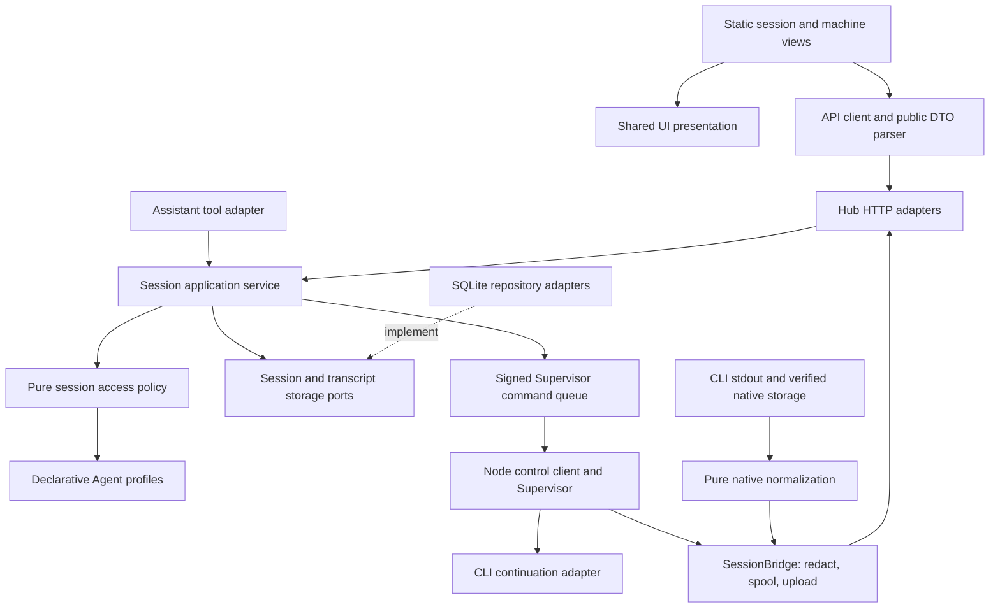

# Agent capability architecture

This is the development contract for native Agent tasks, session continuation,
capture and browser controls. Runtime support and installed-client acceptance are
recorded separately in [the platform acceptance matrix](testing/agent-platform-acceptance.md).
The surrounding system remains [push-only](architecture-v3.md); backend, static
frontend and signed node client releases remain independently packaged.

The browser-facing registered task directory and accepted-submission recovery
share `TaskService` with the assistant; their HTTP, domain and transactional
repository responsibilities are documented in the [native task API contract](native-task-api.md).

An upstream design comparison with T3 Code's provider capabilities, durable event
handling, bounded timeline and Agent result lifecycle is recorded in the
[T3 Code source architecture reference](research/t3code-architecture-reference.md).

The additive, read-only per-session protocol and capture facts are defined by
[Agent observation contract](agent-observability.md). They are projected from
durable redacted events and explicit metadata, never inferred authorization or
current installation status.



## Responsibilities and dependency direction

| Boundary | Code | Owns | Must not own |
|---|---|---|---|
| Shared family definition | `agent_profiles.py` | Family aliases, default commands, potential resume support, runner-only constraint, catalog model protocol | Installation detection, authority grants, process execution |
| Shared wire validation | `session_schema.py`, `fleet_core/session_models.py` | Bounded events/public fields and private model-delivery validation | Hub repositories, browser state, node launchers |
| Shared evidence projection | `fleet_core/agent_evidence.py` | Fixed observed/unknown/unsupported facts and provenance | Authority grants, I/O, vendor installation guesses |
| Hub domain | `hub/domain/session_access.py` | Pure projection of family policy, authoritative adoption snapshot, capture claims and enabled actions into public session access | HTTP, SQLite, filesystem/process probes, command issuance |
| Hub storage ports | `hub/domain/session_ports.py` | Structural `SessionStore` / `TranscriptStore` protocols, ingest result and bounded storage errors | SQL, encryption keys, schema migration |
| Hub application | `hub/application/session_service.py` | Load authoritative facts, ingestion/ACK, common HTTP/assistant admission, idempotency and orchestration | Vendor argv, native database layout, browser family policy |
| Hub persistence | `hub/infrastructure/*_repository.py` | SQLite transactions, cursor durability, schema migration and repository port implementations | Browser rendering or endpoint authorization |
| Hub transport/composition | `hub/http/session_routes.py`, `hub/composition/sessions.py` | Authentication, request/response adaptation; instantiate and inject concrete repositories | Native CLI spawn or private node identity |
| Node execution adapters | `tools/adapters/`, `tools/agent_command.py` | Initial CLI syntax, Windows launcher resolution, `native_resume.py` continuation syntax and retained options | Hub authentication, session authority, signed command issuance |
| Node lifecycle | `tools/supervisor/native_resume.py` | Prove exact identity, retained cwd/env/cursor, lifecycle/model guards and execution coordination | Family-specific argv insertion or browser presentation |
| Native event normalization | `tools/session/normalization.py` | Deterministic bounded vendor JSON → normalized message/tool events | Filesystem reads, subprocesses, encryption, uploads, echo lifecycle |
| Native storage adapter | `tools/session/native_storage.py` | Bounded read-only SQLite snapshots and exact native ID/cwd verification | Latest-session guessing or writes to vendor stores |
| Capture orchestration | `tools/session/bridge.py`, `runner_capture.py` | Source selection, per-turn echo suppression, redaction, encrypted spool and upload/ACK lifecycle | Vendor CLI flags, Hub control admission |
| Browser transport | `frontend/assets/api/client.js`, `contracts.js` | HTTP/error boundary, bounded public DTO validation and filtering | Native paths, shell commands, credentials or family capability inference |
| Browser presentation | `frontend/assets/ui/session-capabilities.js`, `source-control.js` | Pure control presentation model and shared DOM component | Network I/O, OS/Agent policy, inferred authorization |

Package direction remains `hub -> fleet_core <- tools`. Shared profiles and
schema modules import neither Hub nor node implementation. An application uses
storage contracts; composition injects SQLite adapters. Storage error and result
names remain importable from their original repository modules as aliases.
Existing `_native_resume_argv`, `continuation_options`, `bridge._shape_native_row`
and `machine.renderSourceControl` entrypoints remain compatible with callers.

## Capability, identity and authority are distinct

1. A profile declares what an adapter can potentially do. It does not prove the
   binary is installed, a native session is bound or a command is authorized.
2. Captured `native_resume` / `model_takeover` metadata records node evidence.
   Adoption machine/family/status comes from the adoption repository, overriding
   capture provenance. A revoked, missing or pending adoption cannot be revived
   by capture claims.
3. `project_session_access()` intersects enabled Supervisor actions with these
   facts. Runner continuation requires retained native identity evidence; busy
   sessions cannot receive another turn. Hermes/ZCode/agy CLI continuation remains
   limited to Runner-owned sessions. The ZCode desktop bridge is independent.
4. Both HTTP and assistant operations use `SessionService.control()` and its
   current admission check. Rendering a DTO never grants authority; the node
   still checks signatures, target identity and lifecycle before acting.
5. Catalog model configuration is declared by `Profile.model_protocol` and
   derived into `AGENT_PROTOCOLS`. It remains limited to Codex and Claude Code.
   Provider credentials stay in private delivery, never in browser/session DTOs.

A naturally completed CLI with a nonzero exit can retain its recoverable native
conversation. A failed capture drain or unverified process group cannot claim
message delivery. Identity retention and permission to continue are separate.

## Public browser session contract

`allowed_actions` and `control_capability` remain the control authority surface.
The browser filters action names and applies managed/adoption guards; a family
name, OS name or a `capabilities` string never creates a button.

The existing additive fields are now explicitly parsed:

```json
{
  "message_delivery": {
    "available": true,
    "reason": "node_receipt_required",
    "mechanism": "native_session_resume"
  },
  "capture": {
    "native_source_bound": true,
    "history": "retained_source_from_checkpoint",
    "provider_profile_changes_capture": false
  }
}
```

`capture` is present for adoption provenance. Delivery reasons are restricted to
`native_resume_unsupported`, `native_session_unbound`, `session_busy`,
`node_receipt_required`, `control_unavailable`. Mechanisms are
`native_session_resume`, `zcode_desktop_bridge`, `unavailable`.
`control_unavailable_reason` currently admits `native_session_unbound` only.
Unknown properties are discarded; invalid declared field shapes/enums fail with
bounded contract errors. Missing additive fields remain compatible with older
Hubs. A delivery claim can narrow an authorized action, never grant one.

Feature flags still gate optional controls. The view contains no Hermes veto:
verified Hermes Runner sessions use the same follow-up component as other
families. `source-control.js` is shared by machine and session views, avoiding
page-to-page imports. API requests remain in the existing client module.

## Adding or changing an Agent

1. Add/update its `Profile`, alias only if needed, execution adapter and installed
   discovery evidence. Leave unsupported fields disabled.
2. Implement initial and continuation syntax in the node adapter; preserve a
   prompt as a single argv element, Node script prefixes, explicit provider and
   policy options. Never pass browser-provided executable or native path data.
3. Add native row fixtures to the normalization tests. For database-backed
   capture, implement bounded read-only storage and exact ID/cwd verification.
4. Prove durable continuation identity and clean terminal lifecycle before
   reporting resume. Keep source archives and per-turn echo handling intact.
5. If a new control or DTO field is needed, update the domain projection,
   bounded browser parser and presentation together. Reuse the common admission
   service for HTTP and assistant callers.
6. Run the architectural and behavior checks below, native Windows/macOS gates,
   frontend packaging, and scoped actual-client acceptance. An absent CLI is an
   unavailable result, not a runtime pass.

## Architecture and regression gates

- `tests/test_agent_capability_layers.py`: all-family authority matrix,
  adoption/revocation, busy/unbound sessions, desktop isolation, registry-derived
  protocols, Node argv composition, pure-module dependencies, repository ports
  and legacy import compatibility. Included in Windows and macOS CI gates.
- `tests/test_agent_capability_frontend.py`: public DTO allowlists, invalid fields,
  older DTO compatibility, no inferred permission, and actual loopback HTTP /
  Chromium Hermes follow-up at 390 and 1440 pixels with exactly one enqueue.
- `tests/test_boundaries.py`: Hub/node/core package direction and standalone
  node imports; `test_frontend_separation.py`: independent static/API releases.
- Existing continuation, tail-drain, model configuration, transcript, interaction,
  adoption, encrypted spool and browser receipt/reconnect tests retain their
  behavior assertions. A move does not justify rewriting their expected output.

Run focused gates with:

```sh
python3 -m pytest tests/test_agent_capability_layers.py tests/test_agent_capability_frontend.py tests/test_boundaries.py tests/test_session_access_consistency.py tests/test_session_model_takeover.py tests/test_cross_platform_agents.py tests/test_session_bridge.py -q
```

Set `FLEET_PLAYWRIGHT_MODULE` to an existing Playwright installation to run the
Chromium acceptance; it is a test tool, not a frontend runtime dependency.
That capability-architecture refactor introduced no database or signed-command
schema migration. The later ACP/results work below adds the explicit migrations
described in its own contract and test entry points.

## Antigravity ACP and continuation results

New `agy` execution uses the node-owned `tools/providers/` ACP runtime based on
T3 Code's native handshake, eager authentication, exact session resume and
permission response protocol. The adapter launches an owned worker; only that
worker owns vendor stdin. Supervisor verifies the private native identity and
cwd before preserving continuation. Unsupported/failed resume never falls back
to print or creates a sibling conversation. The historical
`tools/session/agy.py` parser remains for retained headless transcript ingestion;
pre-ACP executions cannot resume through the retired print path.

The transport bounds frames and pending/client requests, drains stderr, and
rejects malformed/ambiguous responses. Completion waits for native requests,
post-flush permission acknowledgement and observed background tools. Separate
signed native answers reuse Hub question reservation and idempotency. Nodes
resolve a current process incarnation privately; public control cannot bypass
question admission or deliver raw RPC. Details and lifecycle limitations are in
[the native runtime contract](native-provider-runtime.md).

`agent-chat/results.js` keeps the startup task snapshot. `turn-results.js` reads
command-bound continuation results through public HTTP, with paged metadata and
on-demand bounded patches. The node uses a private Git index and per-turn
baseline; it does not mutate the Agent's index or overwrite startup output.
Result storage and native capability evidence use independent atomic schema
migrations and explicit unavailable/unknown states.
