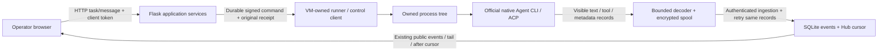

# vm2api source comparison and native VM execution reliability

Date: 2026-11-27. Implementation and verification are tracked in
[the execution plan](../superpowers/plans/2026-11-27-vm-native-stream-reliability.md).
The authoritative Fleet behavior remains [native provider runtime](../native-provider-runtime.md),
[native tasks](../native-task-api.md) and [native sessions](../native-session-api.md).

## Source evidence and limits

Reference repository: [dofastted/vm2api](https://github.com/dofastted/vm2api), public
`main` commit `2eab36cb90b0897aed1cbcf911ae6f4a0d88ca81`, dated 2026-11-27.
The repository's default branch was `dev` when inspected; this comparison pins
`main` explicitly rather than allowing an unnoticed branch change. The complete
recursive Git tree was not truncated. It contains no `.rs` files and no kernel
source tree. Public control-plane source and its documented internal contracts
can be inspected; the full kernel's process injection/PTY/native observation
implementation cannot be independently reviewed from this snapshot.

The source was read as selected small text blobs, without downloading releases,
VM images, native binaries or the complete repository. Its custom license allows
noncommercial learning/research/self-hosting and requires separate commercial
authorization. Fleet implements its own existing interfaces; no upstream source
or binaries are copied into the product.

| Evidence | What it establishes |
|---|---|
| [INFERENCE.md](https://github.com/dofastted/vm2api/blob/2eab36cb90b0897aed1cbcf911ae6f4a0d88ca81/docs/INFERENCE.md) | Node control plane, Rust CLI hop, native process execution, native-handoff terminal evidence and documented deployment/capability boundaries |
| [rust-kernel-client.mjs](https://github.com/dofastted/vm2api/blob/2eab36cb90b0897aed1cbcf911ae6f4a0d88ca81/src/lib/transport/rust-kernel-client.mjs) | Private `kernel.sock` transport mapping; process-up, ready, busy/recovering and restart-needed are different predicates |
| [go-worker-client.mjs](https://github.com/dofastted/vm2api/blob/2eab36cb90b0897aed1cbcf911ae6f4a0d88ca81/src/lib/transport/go-worker-client.mjs) | Actual HTTP/socket request transport, request-ID cancellation, incremental decoding, commit boundary, first-byte/idle timers and terminal metadata processing; legacy file name does not imply a Go inference fallback |
| [kernel-router.mjs](https://github.com/dofastted/vm2api/blob/2eab36cb90b0897aed1cbcf911ae6f4a0d88ca81/src/lib/transport/kernel-router.mjs) | Readiness/admission and bounded wait before inference, managed runtime recovery and cancellation checks |
| [kernel-lease.mjs](https://github.com/dofastted/vm2api/blob/2eab36cb90b0897aed1cbcf911ae6f4a0d88ca81/src/lib/pool/kernel-lease.mjs) | Inflight execution permits are distinct from session affinity and hot native processes; reported capacity is observational input |
| [slot-runtime-admission.mjs](https://github.com/dofastted/vm2api/blob/2eab36cb90b0897aed1cbcf911ae6f4a0d88ca81/src/lib/vm/slot-runtime-admission.mjs) | A nested startup may reuse only its own reservation; independent calls do not inherit admission |
| [stream-keepalive.mjs](https://github.com/dofastted/vm2api/blob/2eab36cb90b0897aed1cbcf911ae6f4a0d88ca81/src/lib/protocol/stream-keepalive.mjs) | Downstream keepalive is distinct from upstream progress; do not split an in-flight SSE frame or fabricate content progress |
| [stream-truncation.mjs](https://github.com/dofastted/vm2api/blob/2eab36cb90b0897aed1cbcf911ae6f4a0d88ca81/src/lib/protocol/stream-truncation.mjs) | Legacy truncation recovery exists, but negotiated native handoff explicitly refuses to manufacture a successful terminal event |

The actual documented route includes Docker slot containers and private Unix
sockets. Neither a container nor a socket alone proves a clean hardware VM.
The public docs also distinguish patched wrap clients from native CRAG V2.
Accordingly, the broad description “all upstream model output comes from an
unmodified official client in a fully isolated VM” is not a fact established by
the public control-plane code. Fleet's supported official CLI/ACP protocols and
its own observable node execution remain the implementation boundary.

## Fleet's corresponding execution chain

The host-to-guest channel is the existing authenticated runner/control protocol.
An actual VM enrolls its unprivileged node and owns its workspace/processes;
the browser never obtains guest filesystem paths, kernel sockets, argv or native
OAuth credentials. There is no need for a second host RPC daemon, unauthenticated
TCP injection endpoint or an API credential that bypasses operator authorization.
A machine-local ACP stdio connection is inside this execution boundary, not the
browser's communication transport.

Fleet is an Agent development/control service: a prompt can execute native tools
and change a workspace. Therefore an uncertain accepted prompt is never retried
merely because its HTTP/stream failed, a different account is available or the
process appears idle. Existing task/message tokens and node journals recover
the original operation. Refresh and reconnect read retained Hub cursors.

## Decisions implemented in this iteration

### 1. Incremental bounded native stream reading

Owned ACP pipes are unbuffered (`bufsize=0`). CPython FileIO's inherited
`readline()` reads a byte at a time. The old reader could perform hundreds of
thousands of reads for a single valid native frame. It now reads at most 64 KiB
of available bytes with `read1()` for buffered streams or `read()` for the owned
raw pipe. It retains at most one partial frame of 1 MiB, including its newline.
Coalesced records are processed in order before another read; there is no
unbounded decoded-event queue and the synchronous capture consumer supplies
backpressure. UTF-8 is decoded strictly only after a complete frame. One-byte
Unicode fragments, CRLF, exact limits, oversized records and partial EOF retain
deterministic bounded behavior. Partial EOF uses the existing `frame_too_large`
framing error family for compatibility; no partial JSON becomes assistant text.

An independent CPython FileIO count experiment used a 262208-byte JSON line:
legacy `readline` performed 262208 `read` calls; incremental framing performed 5.
This is local framing evidence, not a model throughput/VM capacity benchmark.

### 2. Dispatch, cancellation and transport shutdown

The existing one-second write budget now includes serialization, lock contention,
queue admission and write/flush acknowledgement under one monotonic deadline.
Lock waiters inspect cancellation/errors at most every 50 ms. A request already
cancelled before dispatch, including cancellation while waiting for the writer,
is not queued. Once accepted into the writer, delivery can be ambiguous: a
write timeout fails the connection and never triggers prompt replay. Notification
writes remain available for the runtime's native cancellation before it closes.
The runtime/Supervisor still own subsequent process cleanup.

The first terminal transport error wins under a state lock and wakes all pending
RPCs with the same bounded code. Explicit close supplies `protocol_eof` when no
prior error exists; callers no longer wait for the provider's EOF or a long RPC
timeout. Queue count, pending request count, client callbacks and frame limits
retain their existing bounds. Closing the transport does not imply a blocked OS
pipe thread or the native process has exited; owned process teardown releases
those pipes, verified by a real stalled-stdin subprocess test.

### 3. Protocol completion and process completion require separate proof

A valid ACP `end_turn`, stdout EOF and native leader exit are different facts.
EOF means all handles to that pipe closed, while redirected descendants may
still run. Both Supervisor completion branches now require successful bounded
`group_reap()` and confirmed group absence before releasing the private handle,
removing ownership or marking the manifest terminal.

Unconfirmed cleanup returns `escape_unverified` and exit 125, retains the private
handle/owner and keeps a nonterminal manifest. A follow-up is refused with the
same bounded code; restart preserves this fence. A later explicit stop can
verify cleanup. Confirmed clean EOF retains the original exit code and `finished`;
a tail drain timeout with confirmed cleanup retains `group_remaining` / 124.
No internal process-table or cleanup exception text is published.

### 4. End-to-end stream evidence

An independent stdio peer emits visible Unicode text plus an unfinished tool,
then blocks on a test-only acknowledgement. The actual Supervisor/worker and
RunnerCapture encrypt/persist/upload these events into a temporary Hub/SQLite.
Only after operator HTTP reads observe both in-flight events does the test
release the peer to produce tool result, final text and terminal RPC. Forward
reads from the saved Hub cursor then return the later events without overlap.
The test does not infer real-time delivery from post-completion transcript reads.
No real vendor binary, model or OAuth service is involved.

## Compatibility and architecture boundaries

- Existing HTTP endpoints and request/response DTOs remain unchanged. PR #109's
  task targets, token-based task/message recovery, native question protocol and
  tail/before/after event pagination remain compatible.
- No new database field, migration, dependency, broker, gateway or frontend code.
- Supervisor proof changes protect all managed Agent families on supported
  platforms. Incremental ACP framing specifically applies to Agy's ACP runtime;
  other Agent decoders retain their existing native protocols.
- Neither a claimed family name nor process presence creates capability: Agy
  authentication, negotiated exact-session resume, pending approvals, tools and
  native terminal checks continue to be required.
- Full clean-VM lifecycle provisioning, snapshot reset, workspace import/export,
  external OpenAI/Anthropic API compatibility, additional provider protocol hosts
  and VM capacity policy each require a separate scoped design/acceptance. This
  iteration strengthens the existing working chain and does not claim these
  additional services are implemented.
- Real Windows/macOS CI, actual installed-client versions, account authorization
  and production deployment are separate evidence from local fixture success.
  Use [testing entry points](../testing/README.md) and the execution plan's final
  verification record for what actually ran.
