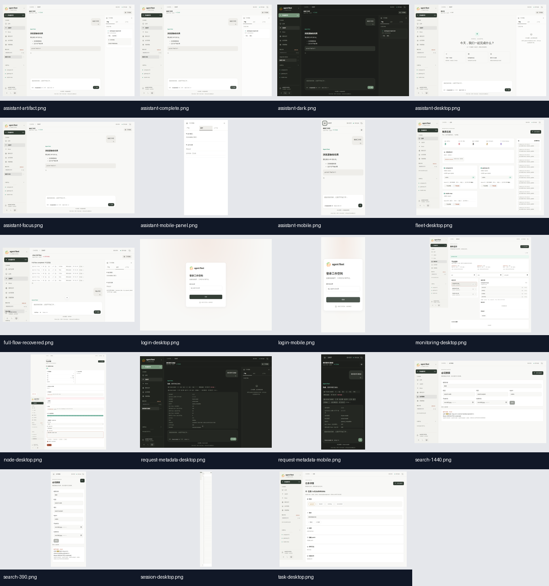

# UI visual evidence

This page records the visual evidence produced for revision
`136915220efb8cde80c25e4660b16412781993be` by
[CI run 41792242807](https://github.com/dengyie/agent-fleet/actions/runs/41792242807).
The source artifact is `agent-fleet-test-evidence`; its downloaded ZIP has
SHA-256 `3ce4d101d85823386bbd692ae650a31a6ebb764da7e2ddf3f3d1b43621683802`
and contains the 19 PNG files below, `journeys.json`, and `results.xml`.
The repository copies preserve the original PNG bytes so the evidence remains
available after the CI artifact's seven-day retention period.

The contact sheet is a durable review aid. The CI artifact remains the source
of truth for the full-resolution bytes and is retained according to the
workflow policy.

## Coverage inventory

| Evidence | Viewport | Surface verified |
|---|---:|---|
| [`assistant-desktop.png`](../assets/visual-evidence/full/assistant-desktop.png) | 1440 x 1000 | Assistant initial desktop layout |
| [`assistant-complete.png`](../assets/visual-evidence/full/assistant-complete.png) | 1440 x 1000 | Completed response and composer layout |
| [`assistant-artifact.png`](../assets/visual-evidence/full/assistant-artifact.png) | 1440 x 1000 | Artifact presentation |
| [`assistant-dark.png`](../assets/visual-evidence/full/assistant-dark.png) | 1440 x 1000 | Dark theme contrast and layout |
| [`assistant-focus.png`](../assets/visual-evidence/full/assistant-focus.png) | 1440 x 1000 | Keyboard/focus-visible state |
| [`assistant-mobile.png`](../assets/visual-evidence/full/assistant-mobile.png) | 390 x 844 | Assistant mobile layout |
| [`assistant-mobile-panel.png`](../assets/visual-evidence/full/assistant-mobile-panel.png) | 390 x 844 | Mobile navigation/panel layout |
| [`fleet-desktop.png`](../assets/visual-evidence/full/fleet-desktop.png) | 1440 x 1075 | Fleet dashboard cards and event rail |
| [`node-desktop.png`](../assets/visual-evidence/full/node-desktop.png) | 1440 x 1811 | Machine detail and long-page flow |
| [`task-desktop.png`](../assets/visual-evidence/full/task-desktop.png) | 1440 x 1077 | Task state, result, and action layout |
| [`monitoring-desktop.png`](../assets/visual-evidence/full/monitoring-desktop.png) | 1440 x 1350 | Service health and bounded actions |
| [`session-desktop.png`](../assets/visual-evidence/full/session-desktop.png) | 1440 x 11443 | Full session detail and transcript flow |
| [`search-1440.png`](../assets/visual-evidence/full/search-1440.png) | 1440 x 900 | Session search desktop layout |
| [`search-390.png`](../assets/visual-evidence/full/search-390.png) | 390 x 1051 | Session search mobile layout |
| [`request-metadata-desktop.png`](../assets/visual-evidence/full/request-metadata-desktop.png) | 1440 x 1000 | Request details on desktop |
| [`request-metadata-mobile.png`](../assets/visual-evidence/full/request-metadata-mobile.png) | 390 x 844 | Request details on mobile |
| [`login-desktop.png`](../assets/visual-evidence/full/login-desktop.png) | 1440 x 1000 | Login desktop layout |
| [`login-mobile.png`](../assets/visual-evidence/full/login-mobile.png) | 390 x 844 | Login mobile layout |
| [`full-flow-recovered.png`](../assets/visual-evidence/full/full-flow-recovered.png) | 1280 x 720 | Uncertain HTTP-502 outcome after failure/reload |

## What these images prove

- Every PNG is decodable, has non-zero dimensions, and contains non-uniform
  pixels. The 19-image contact sheet was reviewed as a single set for blank
  output, major overlap, clipped controls, and inconsistent responsive layout.
- Desktop and 390 px mobile evidence exists for login, assistant, search, and
  request metadata. Long-page evidence exists for node, task, monitoring, and
  session views.
- `full-flow-recovered.png` intentionally captures the unknown-result branch:
  it shows an HTTP 502 and “结果待确认”, so it is not evidence of a successful
  recovered response.
- These images contain fixture data. They prove browser rendering of the tested
  revision; they do not prove production account data, external provider
  behavior, mail delivery, or a real remote node.

## Deliberate boundaries

This release did not capture a logged-in production UI, run external model,
mail, or real-node acceptance, or open a production Muse account. The public
production smoke verified the release manifest, health endpoint, public routes,
and anonymous authentication boundary. Those facts must not be relabeled as
screenshots of live authenticated behavior.

The contact sheet is a review aid; open the linked originals directly for long
screens such as `session-desktop.png`. When UI behavior changes, the required
browser journeys must regenerate the relevant screenshots. Update this
inventory and contact sheet only from a clean CI run for the released revision.
