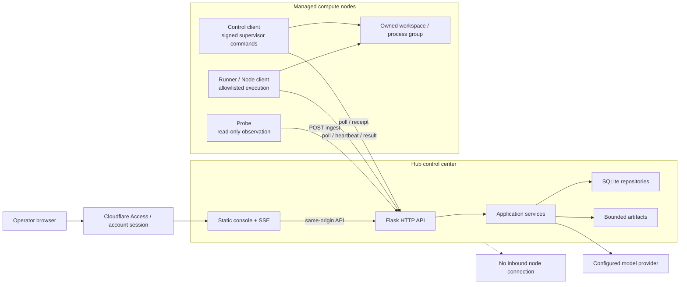
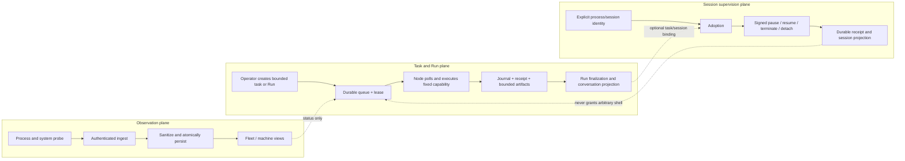
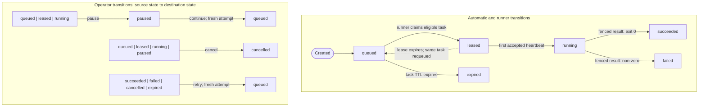
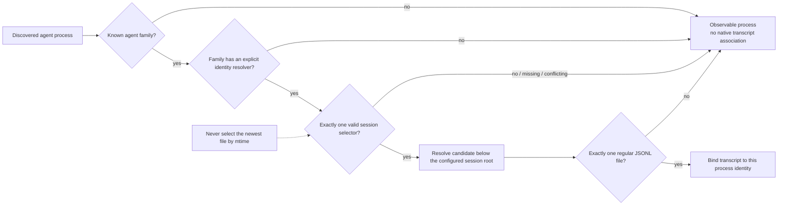
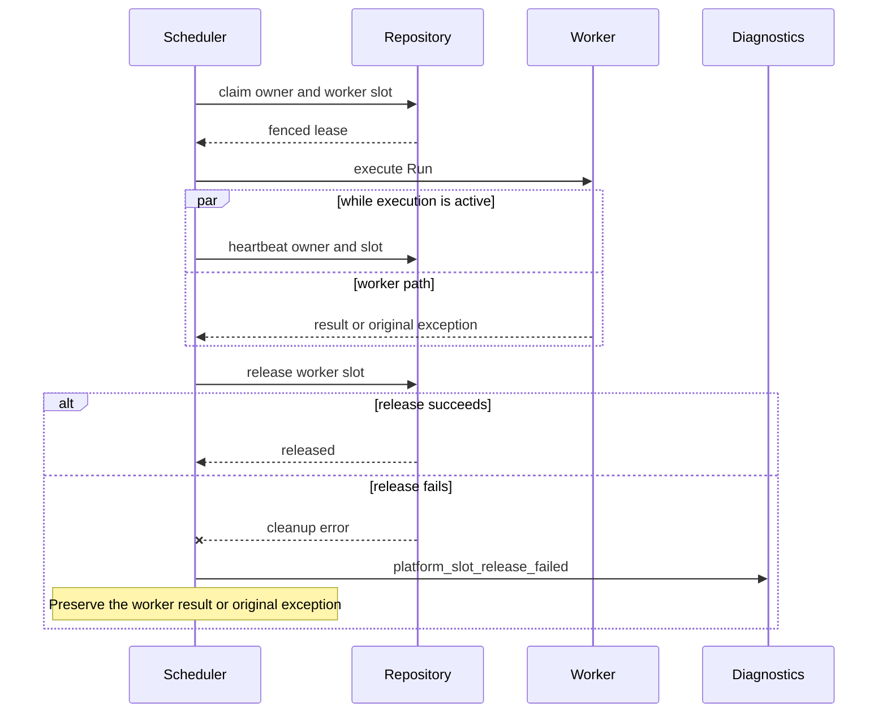
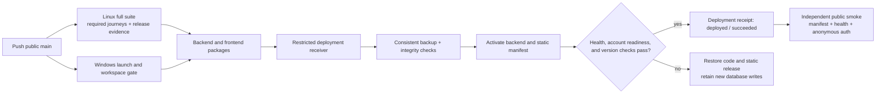

# Agent Fleet visual architecture

This document is the visual companion to
[Architecture v3](architecture-v3.md),
[Control Plane v4](architecture-v4-control-plane.md), and the
[self-hosted platform contract](platform/agent-fleet-self-hosted-platform.md).
The diagrams show the current production boundaries. Historical pull-based SSH
collection is intentionally absent.

## System topology

Node-side clients initiate every connection. The Hub never opens SSH, agent,
or browser ports on a managed node.

## Data and control planes

## Task and attempt state machine

Every claim, heartbeat, result, retry, and continuation is fenced by task,
attempt, lease, and worker identity. Task TTL expiry applies only while queued;
lease expiry requeues the current leased or running attempt. An unknown write
outcome is retained and is not replayed as a new write.

## Native transcript identity resolution

Codex accepts an explicit resume identity, Claude Code accepts an exact
session ID, and Pi accepts an explicit session path or ID constrained to its
configured root. Families without a stable selector remain unassociated.

## Scheduler execution lifecycle

Slot release is durable housekeeping. Its failure is recorded but cannot
replace a successful worker result or mask the worker's original exception;
the lease remains reclaimable by expiry and reconciliation.

## Release and production verification

The deployment job only accepts artifacts from the same clean revision and CI
run. A green pull request does not deploy, and fixture screenshots do not
substitute for external model, mail, or real-node acceptance.

## UI evidence

The current UI evidence inventory and durable contact sheet are in
[UI visual evidence](testing/visual-evidence.md). Individual full-resolution
screenshots remain attached to the CI run because they are test evidence, not
product assets.
