# Agent Fleet visual architecture

This document is the visual companion to
[Architecture v3](architecture-v3.md),
[Control Plane v4](architecture-v4-control-plane.md), and the
[self-hosted platform contract](platform/agent-fleet-self-hosted-platform.md).
The diagrams show the current production boundaries. Historical pull-based SSH
collection is intentionally absent.

## System topology


[Full-resolution PNG](assets/architecture/system-topology.png)

<details>
<summary>Mermaid source</summary>

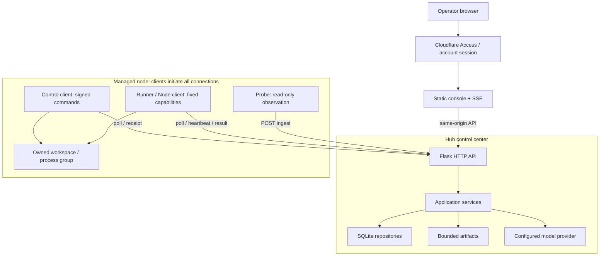

</details>

Node-side clients initiate every connection. The Hub never opens SSH, agent,
or browser ports on a managed node.

## Data and control planes


[Full-resolution PNG](assets/architecture/data-control-planes.png)

<details>
<summary>Mermaid source</summary>

```mermaid
flowchart TB
    subgraph Observation["Observation"]
        P1["Process and system probe"] --> I1["Authenticated ingest"]
        I1 --> S1["Sanitize + atomic persistence"]
        S1 --> V1["Fleet / machine views"]
    end
    subgraph Execution["Task and Run"]
        O2["Operator creates bounded work"] --> Q2["Durable queue + lease"]
        Q2 --> N2["Node polls fixed capability"]
        N2 --> R2["Journal + receipt + artifacts"]
        R2 --> F2["Finalize Run + conversation"]
    end
    subgraph Supervision["Session supervision"]
        D3["Explicit process/session identity"] --> A3["Adoption"]
        A3 --> C3["Signed pause / resume / terminate / detach"]
        C3 --> E3["Receipt + session projection"]
    end
```

</details>

The observation view supplies status, not execution authority. A completed Run
may carry an explicit task/session binding into adoption; supervision never
grants arbitrary shell access. These are separate contracts, not implicit
transitions between the three planes.

## Task and attempt state machine


[Full-resolution PNG](assets/architecture/task-attempt-states.png)

<details>
<summary>Mermaid source</summary>

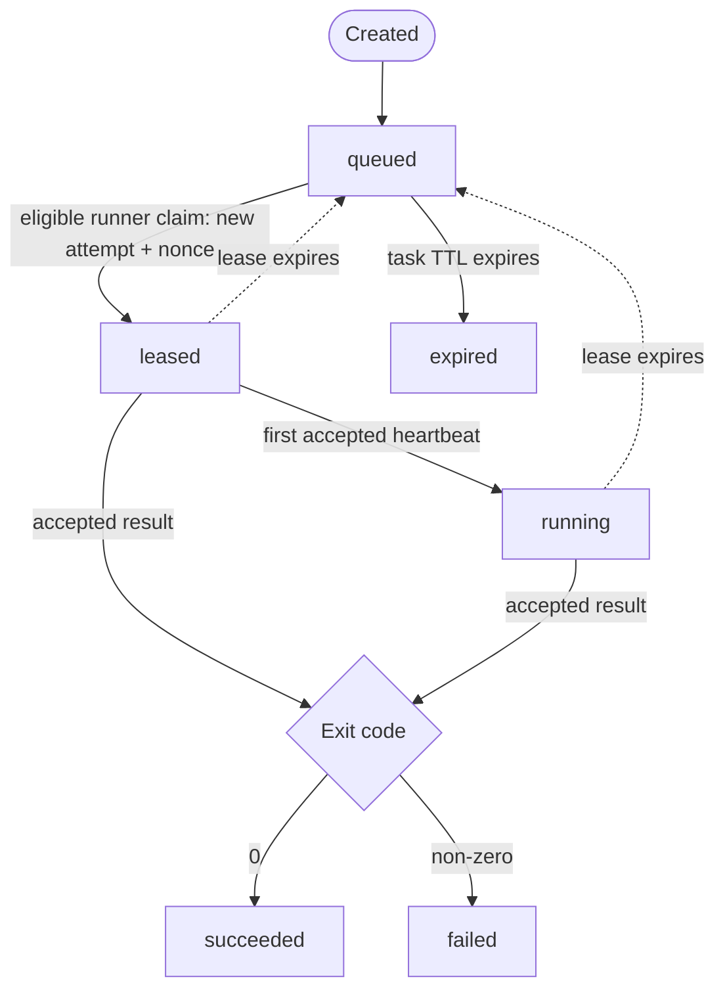

</details>

Operator transitions are validated separately from runner events:

| Action | Allowed source states | Destination |
|---|---|---|
| pause | queued, leased, running | paused |
| continue | paused | queued, fresh attempt |
| cancel | queued, leased, running, paused | cancelled |
| retry | succeeded, failed, cancelled, expired | queued, fresh attempt |

Runner claims create an attempt and nonce-bound lease. Heartbeats and results
must name the current attempt and nonce; both are rejected after lease expiry
or when the task is no longer leased/running. Task TTL expiry applies only while
queued; lease expiry requeues the current leased or running attempt. Operator
pause, cancel, retry, and continue transitions are checked against their
allowed source states; retry and continue create a fresh attempt. Unknown
platform write outcomes are retained rather than replayed, a separate contract
from this legacy task queue.

## Native transcript identity resolution


[Full-resolution PNG](assets/architecture/transcript-identity.png)

<details>
<summary>Mermaid source</summary>

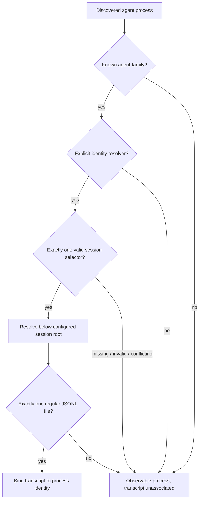

</details>

The resolver never selects the newest file by mtime.

Codex accepts an explicit resume identity, Claude Code accepts an exact
session ID, and Pi accepts an explicit session path or ID constrained to its
configured root. Families without a stable selector remain unassociated.

## Scheduler execution lifecycle

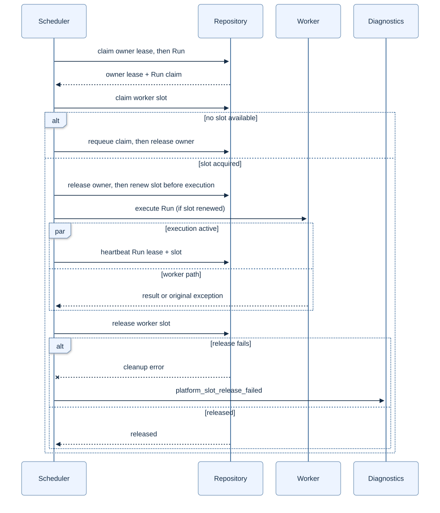

[Full-resolution PNG](assets/architecture/scheduler-lifecycle.png)

<details>
<summary>Mermaid source</summary>

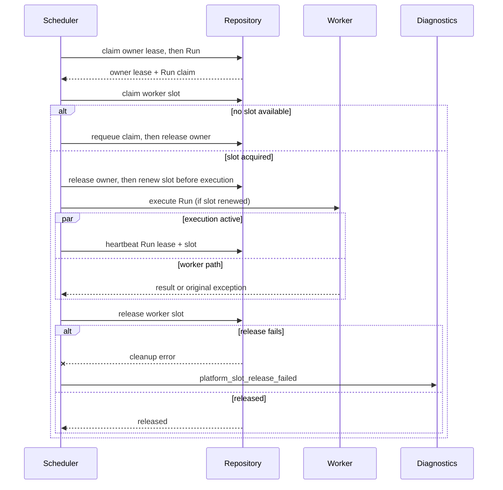

</details>

The sequence starts with an eligible Run claim. An idle owner or a Run already
resolved by cancellation/recovery releases the owner lease without execution.
Slot contention requeues the claim without consuming an execution attempt.
Loss of the heartbeat changes a returned result to `lease_lost`; an original
worker exception still propagates.

Slot release is durable housekeeping. Its failure is recorded but cannot
replace a successful worker result or mask the worker's original exception;
the lease remains reclaimable by expiry and reconciliation.

## Release and production verification


[Full-resolution PNG](assets/architecture/release-verification.png)

<details>
<summary>Mermaid source</summary>

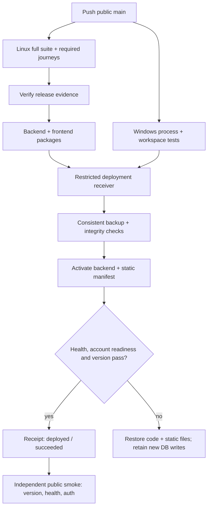

</details>

Linux tests are required to build the release packages. Deployment waits for
Linux tests, Windows launch-policy tests, and both packages. The deployment job
only accepts artifacts from the same main revision and CI run. A green pull
request does not deploy, and fixture screenshots do not substitute for external
model, mail, or real-node acceptance.

## UI evidence

The current UI evidence inventory, durable contact sheet, and full-resolution
screenshots are in [UI visual evidence](testing/visual-evidence.md). The
repository copies are unchanged CI fixture evidence, not product assets.

## Reproducing the diagrams

The six Mermaid blocks above are the editable source. The committed SVG and
PNG exports are generated from those exact blocks, with content-sized canvases
and selectable SVG text. `assets/architecture/render-manifest.json` records each
source hash, export hash, dimensions, and renderer versions. UI screenshots
remain separate test evidence.

With Mermaid 12.3.0 and Playwright 1.63.0 already installed outside the runtime:

```bash
FLEET_MERMAID_MODULE=/path/to/node_modules/mermaid \
FLEET_PLAYWRIGHT_MODULE=/path/to/node_modules/playwright \
FLEET_BROWSER_CHANNEL=chrome node tools/docs/render-architecture.cjs
```

The renderer uses an isolated headless browser for local documentation. It does
not connect to a user browser or a running Fleet instance.
